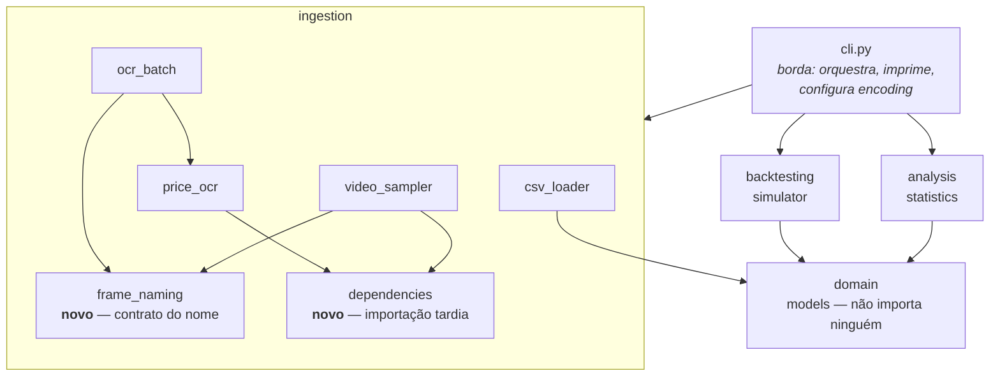
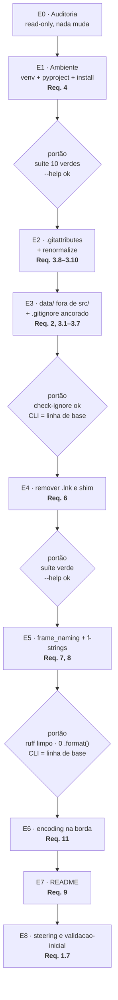

# Design técnico — fundacao-projeto

> **Fase: design gerado.** Aguardando revisão humana.
> Este documento responde **como**. O **o quê** está em `requirements.md`
> (11 requisitos, 74 critérios EARS + 5 restrições transversais) e não é
> reaberto aqui.

---

## 1. Visão geral

### 1.1 O que é "o sistema" neste design

O sistema é o **repositório e o ambiente de desenvolvimento**: a árvore de
arquivos, `pyproject.toml`, `.gitignore`, `.gitattributes`, a suíte de testes,
o linter e o README. Por isso este design descreve, além de assinaturas de
módulo, o **conteúdo pretendido de artefatos de repositório** — nesta spec eles
*são* a interface.

### 1.2 O que muda e o que não muda

| Não muda (restrição transversal) | Muda |
|---|---|
| Organização lógica em camadas `domain` / `ingestion` / `analysis` / `backtesting` / `cli` | Disposição física: dados saem de `src/` |
| Regra de dependência em sentido único | Ferramental: `pytest`, `ruff`, grupo `dev`, venv |
| Comportamento observável do pipeline (20 amostras, mín. 110037, máx. 220074) | Sintaxe de interpolação (`.format()` → f-string) |
| Pré-processamento de imagem, padrão de preço, estatísticas, simulador | Localização do contrato do nome de frame |
| Casos de teste `unittest` existentes | Executor de testes (`unittest` → `pytest` como runner) |
| Assinaturas públicas de `sample_video`, `read_price`, `process_frames`, `load_samples`, `summary`, `run` | Corpo dessas funções, onde a interpolação ou a importação tardia exigem |

### 1.3 Estado real na data do design (18/11/2026)

Verificado antes de projetar, e **mais recente que o texto de `requirements.md`**:

| Item | Estado |
|---|---|
| Achatamento (Requisito 1) | ✅ **executado e commitado**. Conteúdo na raiz de `market-analyzer/`; `o/` não existe |
| Histórico git | ✅ 3 commits (`35fdcc9` start repo → `47d5603` flatten → `b370f73` docs); `git log --follow` atravessa a movimentação |
| Árvore de trabalho | limpa; `origin/main` 2 commits atrás, **não enviado** (chave SSH não configurada) |
| Python | 3.12.10 em `C:\Program Files\Python312`; **não há venv** |
| `pytesseract`, `imageio_ffmpeg`, binário Tesseract | ❌ ausentes; `pip install -e .` nunca executado |
| Testes | 8 passam; `tests/test_video_sampler.py` **não importa** |
| `.format()` | 21 usos; zero f-strings |
| `.gitattributes` | ❌ não existe (V-24) |
| `.gitignore` | ainda o antigo, regras mal ancoradas (V-17) |
| `README.md` | ainda desatualizado (V-15) |
| `pyproject.toml` | sem `optional-dependencies` (V-20) |

**Consequência explícita para o Requisito 1:** dos sete critérios, **1.1 a 1.6
já estão satisfeitos**. Resta apenas o **1.7** — varrer documentos versionados
e atualizar caminhos `o/` que sirvam de **instrução**, preservando os do
registro histórico em `validacao-inicial.md` (decisão 3 da revisão). O design
não planeja refazer o achatamento.

O critério **10.4** ("`git mv` ou equivalente, nunca cópia seguida de
exclusão") foi cumprido no **efeito**, não na **letra**: a movimentação foi
feita fora do git e o histórico se preservou pela detecção de renomeação no
commit `47d5603`, já verificada com `git log --follow`. O design registra isso
como satisfeito *a posteriori* — ver §11, ponto A-1.

---

## 2. Alinhamento com o steering

| Fonte | Diretriz aplicada neste design |
|---|---|
| `product.md` — fronteira decidir/executar | Nenhum módulo de `ingestion`/`analysis`/`backtesting` imprime, encerra processo ou configura terminal. Falha vira **exceção com mensagem acionável**; a borda decide como apresentar (§7) |
| `product.md` — falhar alto | `frame_seconds()` levanta `ValueError` em nome fora do contrato em vez de adivinhar (§6.1) |
| `tech.md` — camadas | `frame_naming` e `dependencies` ficam **dentro de `ingestion`**; nada importa para cima (§4, D-1) |
| `tech.md` — importação tardia de dependência pesada | `imageio_ffmpeg` e `pytesseract` passam a ser importados dentro da função que os usa (§4, D-2) |
| `tech.md` — f-string com exceção de template-contrato | A exceção é resolvida por **extração de função**, não por `# noqa` (§4, D-1) |
| `tech.md` — type hints modernos, `pathlib.Path`, `build_parser()`/`main()` | Mantidos em todo módulo novo e alterado (§5) |
| `tech.md` — idioma | Identificadores, docstrings e mensagens de programa em **inglês**; documentação e colunas de CSV em **português** |
| `structure.md` — estrutura de destino | §3.2 converge para ela, com uma correção necessária apontada em §11, A-3 |
| `structure.md` — nomenclatura de frame | `frame_{segundos:06.1f}s.png` preservado byte a byte (§6.1) |

---

## 3. Arquitetura

### 3.1 Camadas (preservadas, com os dois módulos novos posicionados)



Verificações da regra de dependência:

- `frame_naming` e `dependencies` importam **apenas a biblioteca padrão**
  (`pathlib`, `re`, `types`). Não importam `domain`, não importam terceiros.
- As setas `video_sampler → frame_naming` e `ocr_batch → frame_naming` são
  **intracamada**, padrão já existente (`ocr_batch → price_ocr`).
- `ocr_batch` **não** passa a importar `video_sampler` — por isso o contrato
  não mora no escritor (§4, D-1).
- `domain` continua sem importar nada. Nenhuma camada importa `cli`.

### 3.2 Disposição física de destino

```text
market-analyzer/                     ← raiz do repositório git
├─ .git/
├─ .gitattributes                    ← NOVO (V-24, Req. 3.8–3.10)
├─ .gitignore                        ← REESCRITO (V-17, Req. 3.1–3.7)
├─ .venv/                            ← NOVO, ignorado (decisão D-6)
├─ .sdd/
│  ├─ steering/{product,tech,structure}.md
│  └─ specs/fundacao-projeto/{requirements,design,spec.json}
├─ data/                             ← NOVO, fora de src/ (Req. 2)
│  ├─ raw/.gitkeep                   ← conteúdo ignorado, pasta versionada
│  ├─ processed/.gitkeep             ← conteúdo ignorado, pasta versionada
│  ├─ fixtures/.gitkeep              ← conteúdo VERSIONADO por exceção (V-02)
│  └─ reference/
│     ├─ initial_data.csv            ← movido de src/market_analyzer/
│     └─ ocr_samples.csv             ← movido de src/data/processed/
├─ src/market_analyzer/              ← SÓ CÓDIGO
│  ├─ __init__.py
│  ├─ cli.py
│  ├─ domain/{__init__,models}.py
│  ├─ ingestion/
│  │  ├─ __init__.py
│  │  ├─ frame_naming.py             ← NOVO
│  │  ├─ dependencies.py             ← NOVO
│  │  ├─ video_sampler.py
│  │  ├─ price_ocr.py
│  │  ├─ ocr_batch.py
│  │  └─ csv_loader.py
│  ├─ analysis/{__init__,statistics}.py
│  └─ backtesting/{__init__,simulator}.py
├─ tests/
│  ├─ test_market_analyzer.py
│  ├─ test_price_ocr.py
│  ├─ test_video_sampler.py
│  ├─ test_frame_naming.py           ← NOVO
│  └─ test_cli.py                    ← NOVO
├─ pyproject.toml                    ← AMPLIADO (dev, pytest, ruff)
├─ README.md                         ← REESCRITO (V-15, Req. 9)
├─ analise-inicial.md
└─ validacao-inicial.md              ← atualizado ao fim (restrição transversal 5)
```

**Removidos:** `src/market_analyzer/20261116-1555-54.7150164.mp4.lnk` (V-04),
`src/market_analyzer/market_analyser.py` (V-19), `src/data/` (vazio após a
migração).

### 3.3 Fronteiras

```text
┌─ borda ───────────────────────────────────────────────┐
│ cli.main()            configura encoding, imprime,    │
│ video_sampler.main()  traduz exceção em saída         │
│ price_ocr.main()                                      │
│ ocr_batch.main()                                      │
└───────────────────────────────────────────────────────┘
                     ↑ exceções com mensagem acionável
┌─ núcleo ──────────────────────────────────────────────┐
│ funções de ingestion/analysis/backtesting:            │
│ retornam valor ou levantam exceção. Nunca imprimem,   │
│ nunca chamam sys.exit, nunca mexem em sys.stdout.     │
└───────────────────────────────────────────────────────┘
```

---

## 4. Decisões de design

### D-1 — `frame_name()` / `frame_seconds()` moram em `ingestion/frame_naming.py`

*(decisão 5 da revisão, explicitamente adiada para esta fase)*

**Decisão.** Módulo novo `src/market_analyzer/ingestion/frame_naming.py`,
sem dependência de terceiros, contendo a **única** definição do formato:
`frame_name()`, `frame_seconds()`, `sort_frames()` e a constante `FRAME_GLOB`.

**Justificativa.**

1. **Req. 8.6 fixa `ingestion`**, e os dois consumidores (`video_sampler`,
   `ocr_batch`) estão nessa camada. Um módulo irmão é a posição natural.
2. **Não pode morar no escritor** (`video_sampler.py`): `ocr_batch` passaria a
   importar `video_sampler`, que depende de `imageio_ffmpeg`. O leitor de
   frames ficaria refém do decodificador de vídeo — acoplamento falso e
   quebra de importação quando a dependência de vídeo estiver ausente.
3. **Não pode morar em `domain`**: Req. 8.6 proíbe, e o nome de arquivo é
   convenção de artefato em disco, não conceito de negócio.
4. **Não deve morar em `ingestion/__init__.py`**: lógica em `__init__` é
   carregada por qualquer importação da camada e esconde o contrato; a
   convenção de `structure.md` é um módulo nomeado por responsabilidade.
5. **Sem terceiros no módulo** → ele é importável e testável mesmo sem
   `imageio_ffmpeg`, `pytesseract` ou Tesseract instalados. Isso torna o teste
   de ida-e-volta (Req. 8.3) independente de qualquer bloqueio humano.

**Como a exceção "template que é contrato" (Req. 7.5) se resolve.**
Não por `# noqa`, nem por manter `.format()`. O literal
`"frame_{:06.1f}s.png"` deixa de existir nos dois extremos e passa a existir
**uma vez**, dentro de `frame_name()`, onde é escrito como f-string normal.
A regra `UP032` do `ruff` **não dispara** sobre `.format()` chamado em nome de
variável, então a exceção também não depende de supressão para passar no
linter — ela simplesmente deixa de ser uma chamada `.format()`.

**O que é removido.** O `frame_seconds()` local de `ocr_batch.py:13` e a
constante `FRAME_TIMESTAMP` de `ocr_batch.py:10` são apagados; o glob literal
`"frame_*.png"` de `ocr_batch.py:28` é substituído por `FRAME_GLOB`.

**Alternativas descartadas:** `ingestion/frames.py` (nome ambíguo com o
artefato), `ingestion/frame_contract.py` (jargão que não descreve a
responsabilidade), pacote `ingestion/naming/` (um módulo não justifica um
pacote).

---

### D-2 — Dependências externas: importação tardia centralizada em `ingestion/dependencies.py`

**Problema.** Três ausências distintas, com tratamento hoje incompleto e
inconsistente:

| Ausência | Hoje | Requisito |
|---|---|---|
| `imageio_ffmpeg` | `ImportError` no topo de `video_sampler.py` → módulo e teste nunca carregam | 4.5, 5.1, 5.2 |
| `pytesseract` | tratado em `price_ocr.py:44-48`, mensagem manda rodar `pip install -e .` | 4.5 |
| Binário Tesseract | tratado em `price_ocr.py:57-61`, mas **não diz onde obter as instruções** | 4.4, 4.6 |

**Decisão.** Módulo `src/market_analyzer/ingestion/dependencies.py` com:

- `require_imageio_ffmpeg() -> ModuleType` — importa dentro da função; em
  falha, `raise RuntimeError(...) from error` nomeando `imageio-ffmpeg` e
  indicando o comando de instalação.
- `require_pytesseract() -> ModuleType` — idem para `pytesseract`.
- `TESSERACT_NOT_FOUND_MESSAGE: Final[str]` — texto único usado por
  `price_ocr.read_price()` ao capturar `pytesseract.TesseractNotFoundError`,
  identificando o Tesseract como **pré-requisito externo não instalável por
  pip** e apontando a seção de pré-requisitos do `README.md`.

**Como isso respeita a fronteira decidir/executar.** Nada aqui imprime,
encerra processo ou consulta terminal. `require_*` **retorna o módulo** ou
**levanta exceção**: é valor e falha, não ação. A tradução de exceção em texto
na tela e em código de saída continua exclusivamente nos `main()` de borda.
O módulo também não checa o PATH preventivamente — a detecção do binário
ausente continua vindo do `pytesseract.TesseractNotFoundError`, isto é, do
ponto onde a falha realmente ocorre.

**Por que a URL do instalador não vai na mensagem de erro.** URL em string de
código apodrece e duplica o README. A mensagem aponta a seção do README
(`"see 'Pré-requisitos' in README.md"`); o README carrega o link e o comando
de verificação `tesseract --version` (Req. 4.6).

**Efeito colateral desejado.** Com `imageio_ffmpeg` importado tardiamente,
`tests/test_video_sampler.py` passa a **coletar e rodar mesmo sem a
dependência instalada** — os dois casos existentes exercitam só validação de
argumento, que acontece antes do uso do decodificador. Isso torna o Req. 5.1
robusto, e não apenas verdadeiro enquanto o ambiente estiver completo.

**Alternativa descartada:** manter os `try: import ...` inline em cada módulo
(o que `tech.md` endossa). Rejeitada porque a mensagem do Tesseract precisa ser
idêntica e única em dois lugares (`price_ocr` hoje, `ocr_batch` quando a spec
`ocr-confiavel` endurecer o caminho) e porque centralizar dá um só lugar para
corrigir o ponteiro do README. Ver §11, A-4 — é a decisão mais discutível do
documento.

---

### D-3 — Encoding da saída tratado na borda `cli`, por reconfiguração do próprio fluxo

**Decisão.** Função `configure_output_encoding()` em `cli.py`, chamada como
**primeira linha** de `cli.main()`. Ela reconfigura `sys.stdout` e
`sys.stderr` para `encoding="utf-8"`, `errors="backslashreplace"`, de forma
tolerante: se o fluxo não expuser `reconfigure` (substituído por captura de
teste, `StringIO`, pipe exótico), a função **não faz nada e não levanta**.

**Por que isso resolve o V-21 sem mexer na codepage (Req. 11.1, 11.2).**

- Em console real do Windows, o Python escreve pela API de console em UTF-16
  (PEP 528) — acentos chegam corretos independentemente da codepage ativa.
- Quando o fluxo **não** é console (pipe, arquivo, captura por outro
  processo), o Python cai no encoding de locale — `cp1252` ou pior, uma
  codepage OEM, que é exatamente onde `ã` e `ú` viram `?`. Reconfigurar o
  próprio fluxo para UTF-8 elimina essa dependência.
- O programa configura **o fluxo dele**, não o terminal do usuário. Nada
  persiste após a saída do processo. É o que Req. 11.2 pede.

**Req. 11.3 (saída redirecionada).** Com UTF-8 explícito, o arquivo recebe
bytes UTF-8 com acentuação preservada, independentemente do locale da máquina.

**Req. 11.4 (degradação previsível).** `errors="backslashreplace"` em vez de
`"replace"`: um caractere irrepresentável vira a sequência `\uXXXX`, que é
**reversível, inequívoca e local** — nunca `?` (que destrói informação em
silêncio) e nunca uma exceção que arrebentaria a linha no meio. O README
documenta esse comportamento.

**Limite deliberado de alcance.** A função fica em `cli.py` e é chamada
**apenas** por `cli.main()`. Os `main()` de `video_sampler`, `price_ocr` e
`ocr_batch` **não** a usam, porque importá-la de `cli` seria importar para
cima e violaria a regra de dependência. Req. 11.2 nomeia `cli` como a borda a
tratar, e o achado V-21 é na saída do CLI principal (o nome do item). Ver
§11, A-5 — se a revisão quiser cobrir também as CLIs de etapa, a saída é um
módulo utilitário de borda na raiz do pacote, e isso **amplia** o requisito.

**Alternativas descartadas:**

| Alternativa | Por que não |
|---|---|
| `chcp 65001` / `SetConsoleOutputCP` via `ctypes` | Altera o estado do terminal do usuário e persiste após o processo. Efeito colateral no mundo, na borda errada |
| `PYTHONUTF8=1` / `PYTHONIOENCODING` | Variável de ambiente é "o usuário mexendo na configuração", que é justamente o que Req. 11.2 proíbe |
| `print(..., file=open(..., encoding=...))` por chamada | Espalha tratamento de encoding pelo código, contra o pedido explícito do requisito |
| `errors="replace"` | Produz `?`, o próprio sintoma que o requisito manda eliminar |

---

### D-4 — `.gitattributes`: `text=auto` global + binários marcados explicitamente

**Decisão.** Arquivo na raiz, com três blocos nesta ordem:

```gitattributes
# Normalização de fim de linha (V-24, Req. 3.8–3.9).
# LF no conteúdo versionado; cada checkout usa o fim de linha nativo.
* text=auto

# Tipos de texto declarados — não depender apenas da heurística do git.
*.py            text diff=python
*.md            text
*.toml          text
*.csv           text
*.txt           text
.gitignore      text
.gitattributes  text

# Binários: nenhuma conversão de fim de linha pode tocá-los (Req. 3.10).
*.png   binary
*.jpg   binary
*.jpeg  binary
*.mp4   binary
*.avi   binary
*.mov   binary
```

**Decisões embutidas, com motivo:**

- **`* text=auto` sem `eol=lf`.** Acrescentar `eol=lf` forçaria LF também na
  árvore de trabalho, contrariando a letra do Req. 3.8 ("cada checkout usa o
  fim de linha nativo da máquina"). O ambiente de referência é Windows.
- **`binary` é macro de `-text -diff`** — cobre de uma vez a não conversão e a
  não tentativa de diff textual. É o mecanismo que Req. 3.10 pede.
- **Fixtures `.png` versionadas são justamente o caso crítico**: são gabarito
  de OCR; um único byte alterado por conversão de fim de linha invalidaria o
  teste de regressão silenciosamente.
- **`*.csv text`** é seguro: `csv_loader` lê com `newline=""`, que normaliza
  terminadores na leitura, e `ocr_batch` escreve com `newline=""`. O
  ida-e-volta LF↔CRLF não altera valor algum lido pelo pipeline.
- **Passo operacional obrigatório:** adicionar `.gitattributes` não
  re-normaliza o que já está versionado. Depois de criá-lo, rodar
  `git add --renormalize .` e commitar. Sem isso, o Req. 3.9 ("`git status`
  limpo logo após um clone") não fica garantido.

---

### D-5 — `.gitignore`: ancorar na raiz, ignorar **conteúdo** (não a pasta) e exceção por negação

**Decisão.** Reescrita completa:

```gitignore
# --- Ambiente e ferramenta ---
__pycache__/
*.py[cod]
*.egg-info/
.venv/
.pytest_cache/
.ruff_cache/

# --- Editor e logs ---
.idea/
.vscode/
*.log

# --- Mídia: ignorada em qualquer lugar por padrão ---
*.mp4
*.avi
*.mov
*.png
*.jpg
*.jpeg

# --- Dados gerados e brutos ---
# A barra inicial ancora na raiz do repositório. A falta dela era o V-17:
# "data/raw/" com barra no meio já é ancorado, mas na pasta do .gitignore,
# que antes não era a raiz do conteúdo.
# Ignora-se o CONTEÚDO (/*), não a pasta: o git não consegue reincluir nada
# dentro de um diretório excluído, e as pastas precisam existir em um clone.
/data/raw/*
!/data/raw/.gitkeep
/data/processed/*
!/data/processed/.gitkeep

# --- Exceções deliberadas (obrigatoriamente DEPOIS das regras acima) ---
# Fixtures rotuladas: gabarito de teste, versionadas apesar de *.png (Req. 3.3).
!/data/fixtures/**
# Material de referência estável: nunca alcançado pelas regras de dados (Req. 2.4).
!/data/reference/**
```

**Por que `/data/raw/*` e não `/data/raw/`.** Regra do git: *não é possível
reincluir um arquivo se um diretório-pai dele está excluído*. Com
`/data/raw/`, a negação `!/data/raw/.gitkeep` **não funcionaria** e a pasta
não existiria em um clone limpo — Req. 2.2 cairia. Com `/data/raw/*`, a pasta
não está excluída, só o conteúdo, e a negação do `.gitkeep` vale.

**Por que `data/fixtures/` dispensa `.gitkeep` na lógica mas o recebe mesmo
assim.** Nenhuma regra ignora o diretório, então `!/data/fixtures/**` basta
para reincluir os `.png` futuros. O `.gitkeep` entra porque a pasta está
**vazia hoje** (V-02 bloqueado por H-1/H-5) e Req. 2.2 exige presença em clone
limpo.

**`!/data/reference/**` é defensivo e deliberado.** Hoje nada ignora `.csv`;
a negação existe para que o corolário do Req. 2.4 fique **escrito no próprio
mecanismo**, e para que uma regra futura de `*.csv` não revogue a decisão 2 da
revisão em silêncio (Req. 3.5: se a regra alcançar o arquivo, a regra está
errada).

**Auditoria do Req. 3.7.** Depois da reescrita, rodar sobre todos os arquivos
rastreados uma verificação de `git check-ignore`; a saída esperada é **vazia**.
Pela análise estática do conjunto atual de arquivos rastreados, nenhum passa a
casar com regra de ignorar — `ocr_samples.csv` vai para `data/reference/`, que
está explicitamente reincluído. Se a auditoria acusar algo, o arquivo sai do
índice com `git rm --cached` antes de seguir.

---

### D-6 — O projeto passa a usar ambiente virtual `.venv/` na raiz

**Decisão. Sim, venv — explícito, obrigatório e documentado como passo 1 do
README.** Diretório `.venv/` na raiz, já coberto pela regra de ignorar.

**Justificativa.**

1. `pip install -e .` no Python de `C:\Program Files\Python312` exige
   elevação em boa parte das instalações do Windows e, quando não exige,
   escreve no interpretador do sistema.
2. Req. 4.1 fala em "máquina com ambiente limpo". Sem isolamento, "limpo" é
   indefinível e a reprodutibilidade vira sorte.
3. `pytest` e `ruff` instalam executáveis em `Scripts/`; dentro do venv os
   comandos `pytest` e `ruff check .` (a letra dos Req. 5.6 e 7.3) funcionam
   sem qualquer manipulação de PATH.
4. A spec `ocr-confiavel` vai exigir trocar versões de `pytesseract`; fazer
   isso no interpretador do sistema é dívida garantida.

**Como aparece nas instruções (README, Req. 9.5, 9.7):**

```powershell
python -m venv .venv
.\.venv\Scripts\Activate.ps1
python -m pip install -e ".[dev]"
```

**Dois detalhes de execução que o README precisa trazer, ou o Req. 9.7 falha:**

- **Aspas em `".[dev]"`.** Req. 4.1 escreve `pip install -e .[dev]`; o
  comando com aspas é idêntico em efeito e sobrevive a qualquer shell. Sem
  aspas há risco de interpretação do colchete.
- **Política de execução do PowerShell.** Se `Activate.ps1` for bloqueado, o
  README dá a alternativa sem ativação, que funciona sempre:
  `.\.venv\Scripts\python.exe -m pip install -e ".[dev]"` e
  `.\.venv\Scripts\pytest.exe`.

**Nuance de requisito registrada:** criar o venv é um passo manual a mais, e
Req. 4.1 diz "sem nenhum passo manual adicional exceto o binário do
Tesseract". A leitura adotada é que o critério trata de **dependências**, não
de preparação do interpretador. Ver §11, A-6.

---

### D-7 — Ferramental: `pytest` como executor, `ruff` com `UP032` sobre o conjunto padrão

**Decisão.** Acréscimos a `pyproject.toml`:

```toml
[project.optional-dependencies]
dev = [
    "pytest>=9.0",
    "ruff>=0.17",
]

[tool.pytest.ini_options]
minversion = "9.0"
testpaths = ["tests"]
addopts = ["-ra"]

[tool.ruff.lint]
# Conjunto padrão do ruff (E4, E7, E9, F) + a regra exigida pelo Requisito 7.
select = ["E4", "E7", "E9", "F", "UP032"]
```

**Pisos de versão (Req. 4.2 exige versão mínima declarada para cada um):**

- `pytest>=9.0` — linha estável atual (9.2.0, 27/10/2026); `Requires-Python:
  >=3.10`, compatível com o piso do projeto (Req. 4.3). Roda classes
  `unittest.TestCase` sem reescrita (Req. 5.3). Os testes atuais usam `setUp`,
  não os hooks estilo *nose* removidos no pytest 9.
- `ruff>=0.17` — linha estável atual (0.17.5, 12/11/2026). Chave de
  configuração `[tool.ruff.lint]`, vigente desde a 0.5.

**Por que não ampliar o `select`.** Ativar `UP` inteiro, `I` (isort) ou `E501`
geraria violações alheias ao escopo e tornaria o Req. 7.3 ("`ruff check .` sem
nenhuma violação") um trabalho de reformatação não pedido. `E4, E7, E9, F` é o
**padrão do próprio ruff** — declará-lo explicitamente apenas documenta o que
já valeria, e `UP032` é o acréscimo que o Req. 7.2 exige.

**`target-version`** não é declarado: o ruff o infere de
`requires-python = ">=3.10"`, que o Req. 4.3 manda preservar. Uma fonte de
verdade só.

**Por que `testpaths` e não `pythonpath = ["src"]`.** Declarar `pythonpath`
faria a suíte rodar **sem** instalação, mascarando um `pip install -e .`
quebrado — exatamente a falha que o Req. 4 existe para impedir. O caminho
único e verificável é: instalar, depois testar.

**`addopts = ["-ra"]`** faz o resumo do pytest listar motivos de *skip*. É o
que materializa "com motivo declarado na saída" no Req. 5.4.

**Exclusões:** `.venv/` já está no conjunto de exclusões padrão do ruff, e
`testpaths` impede o pytest de descer nele.

**Fora de escopo, registrado para não voltar:** CI, Docker, verificador de
tipos, `ruff format`. `ruff check --fix` é ferramenta de migração (§9, E5),
não formatador automático adotado.

---

### D-8 — `data/reference/` como quarta pasta, versionada, com `.gitkeep` nas outras três

**Decisão.** Quatro pastas sob `data/`, com políticas distintas e escritas:

| Pasta | Conteúdo | Versionado? | Mecanismo |
|---|---|---|---|
| `raw/` | vídeos, frames brutos | ❌ conteúdo ignorado | `/data/raw/*` + `.gitkeep` |
| `processed/` | CSVs gerados pelo pipeline | ❌ conteúdo ignorado | `/data/processed/*` + `.gitkeep` |
| `fixtures/` | frames rotulados (gabarito) | ✅ **por exceção deliberada** | `!/data/fixtures/**` |
| `reference/` | `initial_data.csv`, `ocr_samples.csv` | ✅ material estável | `!/data/reference/**` |

**Movimentação (Req. 2.3, 2.4; decisões 1 e 2 da revisão), com `git mv`:**

- `src/market_analyzer/initial_data.csv` → `data/reference/initial_data.csv`
- `src/data/processed/ocr_samples.csv` → `data/reference/ocr_samples.csv`
- `src/data/` deixa de existir

**Req. 2.5 (nada de dado no pacote instalado).** `pyproject.toml` não declara
`package-data` nem `include-package-data`; com `[tool.setuptools.packages.find]
where = ["src"]`, o setuptools distribui apenas módulos Python. Tirar os dois
CSVs de dentro de `src/` fecha a questão na origem. Verificação objetiva:
nenhum arquivo rastreado sob `src/` com extensão de dado.

**Req. 2.6 (mesmos números).** O comando de referência passa a ser
`market-analyzer --input data/reference/initial_data.csv` e deve reproduzir,
caractere a caractere, a linha de base capturada antes da movimentação:
20 amostras, mínimo 110037, máximo 220074 (confirmado contra as 20 linhas de
`initial_data.csv`). Nenhum módulo tem caminho de dado embutido — a entrada
sempre vem de `--input` —, então a movimentação não toca código.

---

### D-9 — Ordem de execução é parte do design, não preferência

Detalhada em §9. O princípio que a governa: **nenhuma alteração de sintaxe
antes de rede de teste verificada** (Req. 10.1 a 10.3). O caso crítico é
`video_sampler.py` — é o único arquivo cujo teste não roda hoje **e** é um dos
cinco que a migração de `.format()` toca.

---

## 5. Componentes e interfaces

### 5.1 Módulos novos

#### `src/market_analyzer/ingestion/frame_naming.py`

Única definição do contrato do nome de frame. Importa apenas `pathlib`, `re`
e `typing`.

```python
FRAME_GLOB: Final[str] = "frame_*.png"

def frame_name(seconds: float) -> str:
    """Build the canonical sampled-frame filename for a timestamp."""

def frame_seconds(path: Path) -> float:
    """Recover the timestamp encoded in a sampled-frame filename."""

def sort_frames(paths: Iterable[Path]) -> list[Path]:
    """Order sampled frames by their numeric timestamp, never lexicographically."""
```

**Contratos:**

| Função | Entrada válida | Saída | Falha |
|---|---|---|---|
| `frame_name` | `seconds` finito e `>= 0` | `f"frame_{seconds:06.1f}s.png"` | `ValueError` com o valor recebido, se negativo ou não finito |
| `frame_seconds` | `Path` cujo `name` casa o padrão canônico | `float` com uma casa decimal | `ValueError` contendo o nome recebido (Req. 8.4) |
| `sort_frames` | iterável de `Path` canônicos | `list[Path]` ordenada por `frame_seconds` | propaga `ValueError` de `frame_seconds` — falhar alto, não ignorar o intruso |

**Padrão de reconhecimento.** `^frame_(\d{4,}\.\d)s\.png$`, ancorado nas duas
pontas. Mais estrito que o atual `frame_(\d+(?:\.\d+)?)s\.png$` (que usa
`.match()`, sem âncora final efetiva sobre o prefixo e aceita nomes que
`frame_name()` nunca produz). `{:06.1f}` sempre gera no mínimo quatro dígitos
inteiros, então o padrão estrito aceita **tudo** o que o escritor produz e
rejeita o resto. Não há frames em disco hoje (V-01/V-02), logo não há
compatibilidade retroativa a preservar.

**`sort_frames` é pura.** Não varre diretório. Quem varre é `ocr_batch`, com
`frames_dir.glob(FRAME_GLOB)`. Isso mantém o módulo sem I/O e permite testar
a ordenação sem tocar em disco.

#### `src/market_analyzer/ingestion/dependencies.py`

```python
TESSERACT_NOT_FOUND_MESSAGE: Final[str]

def require_pytesseract() -> ModuleType:
    """Import pytesseract, turning absence into an actionable error."""

def require_imageio_ffmpeg() -> ModuleType:
    """Import imageio_ffmpeg, turning absence into an actionable error."""
```

Ambas levantam `RuntimeError` encadeado (`raise ... from error`) nomeando a
distribuição ausente e o comando de instalação, conforme Req. 4.5 e a
convenção de erros encadeados de `tech.md`.

#### `tests/support.py` — **adiado na revisão de 18/11/2026**

A proposta original criava aqui um `tesseract_available()` e um decorador
`requires_tesseract`, para materializar o Req. 5.4 no mecanismo.

**Decisão da revisão: não criar o módulo nesta spec.** Nenhum teste atual
precisa do Tesseract — o único candidato, regressão de OCR sobre fixtures
rotuladas, está bloqueado por V-02 / H-5 e pertence a `ocr-confiavel`. Criar
a guarda agora produziria código sem nenhum chamador, que é dívida nascendo
pronta: ninguém exercita, ninguém percebe quando quebra, e a primeira pessoa
a precisar dela provavelmente vai reescrevê-la de qualquer forma.

**Como o Req. 5.4 fica satisfeito sem o módulo.** O critério exige que,
enquanto o binário não estiver instalado, a suíte conclua sem falha. Isso já
é verdade por desenho, e não por guarda: nenhum teste desta spec toca o
Tesseract, e a importação tardia (D-2) garante que a ausência do binário só
se manifesta em tempo de execução de OCR, nunca em tempo de importação. A
verificação é direta — rodar a suíte completa com o Tesseract ausente, que é
exatamente o ambiente atual, e observar zero falhas.

**Quando o helper nasce.** Em `ocr-confiavel`, junto com o primeiro teste que
realmente precise dele. A forma proposta acima fica registrada aqui como ponto
de partida, para não se perder.

### 5.2 Módulos alterados

| Arquivo | Alteração | Requisito | Etapa |
|---|---|---|---|
| `ingestion/video_sampler.py` | `import imageio_ffmpeg` do topo → `require_imageio_ffmpeg()` dentro de `sample_video()`; nome do frame via `frame_name()` (remove o literal de `:40`); 3 `.format()` → f-string | 4.5, 5.1, 7.1, 8.2 | E5 |
| `ingestion/ocr_batch.py` | remove `FRAME_TIMESTAMP` (`:10`) e o `frame_seconds()` local (`:13`); passa a usar `frame_naming`; `glob("frame_*.png")` → `glob(FRAME_GLOB)`; `sorted(..., key=frame_seconds)` → `sort_frames(...)`; 5 `.format()` → f-string | 7.1, 8.2, 8.5 | E5 |
| `ingestion/price_ocr.py` | `import pytesseract` inline → `require_pytesseract()`; mensagem do Tesseract passa a vir de `TESSERACT_NOT_FOUND_MESSAGE`; 1 `.format()` → f-string | 4.4, 4.5, 7.1 | E5 |
| `ingestion/csv_loader.py` | 3 `.format()` → f-string | 7.1 | E5 |
| `cli.py` | 9 `.format()` → f-string; `configure_output_encoding()` chamada no topo de `main()` | 7.1, 11.1–11.4 | E5, E6 |
| `pyproject.toml` | `[project.optional-dependencies]`, `[tool.pytest.ini_options]`, `[tool.ruff.lint]` | 4.2, 5.3, 7.2 | E1 |
| `.gitignore` | reescrito (D-5) | 3.1–3.7 | E3 |
| `.gitattributes` | criado (D-4) | 3.8–3.10 | E2 |
| `README.md` | reescrito (§5.4) | 9.1–9.8 | E7 |
| `validacao-inicial.md`, `.sdd/steering/*` | achados resolvidos; caminhos de instrução atualizados | 1.7, transversal 5 | E8 |

**Não alterados:** `domain/models.py`, `analysis/statistics.py`,
`backtesting/simulator.py` e todos os `__init__.py` — nenhum contém `.format()`
nem dependência externa. Preservá-los intactos é também evidência direta de
que a restrição transversal 2 (não alterar comportamento) foi respeitada.

**Removidos:** `src/market_analyzer/market_analyser.py` (V-19, Req. 6.2) e
`src/market_analyzer/20261116-1555-54.7150164.mp4.lnk` (V-04, Req. 6.1), ambos
por `git rm` (sai do índice e do disco em uma operação, Req. 6.1 e 6.3). O
ponto de entrada `market-analyzer = "market_analyzer.cli:main"` não referencia
o shim e continua válido (Req. 6.5).

### 5.3 Interface da borda — `cli.py`

```python
def configure_output_encoding(streams: Iterable[TextIO] | None = None) -> None:
    """Force UTF-8 on the process output streams; no-op when unsupported."""
```

O parâmetro opcional existe para **testabilidade**: o padrão é
`(sys.stdout, sys.stderr)`, e o teste passa um fluxo sem `reconfigure` para
provar que a função degrada em silêncio em vez de quebrar o CLI. Sem o
parâmetro, só seria testável mexendo em estado global do processo.

### 5.4 Estrutura do `README.md` (Req. 9)

Seções, na ordem em que uma pessoa nova as executa:

1. **O que é** — pipeline offline de observação; Fase 1 (observador), com o
   limite do método declarado.
2. **Pré-requisitos** — Python 3.10+ e, **em bloco separado do pip**, o binário
   do Tesseract, com link para o instalador de Windows e verificação
   `tesseract --version` (Req. 4.6, 9.5).
3. **Instalação** — venv, ativação, `python -m pip install -e ".[dev]"`,
   `market-analyzer --help` (Req. 4.7, 9.5), com a alternativa sem ativação.
4. **Suíte de testes** — `pytest` (Req. 5.6).
5. **Linter** — `ruff check .` (Req. 7.7).
6. **Exemplo real de CLI** —
   `market-analyzer --input data/reference/initial_data.csv`, com a saída
   esperada transcrita (Req. 9.5).
7. **Estrutura de pastas** — idêntica, pasta a pasta, à de `structure.md` e à
   do disco (Req. 9.4).
8. **Dados** — `raw/` e `processed/` não versionados; `fixtures/` versionada
   **por exceção deliberada** por ser gabarito de teste; `reference/`
   versionada por ser linha de base do V-06 (Req. 9.6).
9. **Comportamento de acentuação** — saída em UTF-8 e a degradação
   `\uXXXX` documentada (Req. 11.4).
10. **Git** — o repositório existe (Req. 9.3).
11. **Documentos** — `analise-inicial.md`, `validacao-inicial.md`.

Some: menção a `src/market_analyzer/storage` (Req. 9.1), `src/tests`
(Req. 9.2), "não depende de um repositório Git" (Req. 9.3) e `src/data`
(Req. 2.7).

---

## 6. Contratos de dados

### 6.1 Nome do frame

```text
frame_{segundos:06.1f}s.png        ex.: frame_0010.0s.png
       │                └─ exatamente 1 casa decimal
       └─ largura mínima 6 incluindo o ponto → mínimo 4 dígitos inteiros
```

| Propriedade | Definição |
|---|---|
| Ida-e-volta (Req. 8.3) | `frame_seconds(Path(frame_name(t))) == float(f"{t:.1f}")` para todo `t` finito `>= 0` |
| Precisão | Uma casa decimal. Valores com mais precisão são arredondados pela formatação; a igualdade do ida-e-volta é definida **contra o valor arredondado**, não contra `t` bruto |
| Ordenação (Req. 8.5) | Sempre por `frame_seconds`, nunca por nome. O padding sustenta a ordem lexicográfica até `9999.9`; de `10000.0` (≈2 h 46 min) em diante o nome ganha um dígito e `frame_10000.0s.png` ordenaria antes de `frame_9999.9s.png` |
| Nome inválido | `ValueError` cuja mensagem contém o nome recebido (Req. 8.4) |
| Local da definição | `ingestion/frame_naming.py`, e **apenas** ali (Req. 8.1) |

### 6.2 Esquema de CSV

Inalterado: `timestamp,item,preco_medio,origem_video,observacao`, colunas em
português, leitura `utf-8-sig`, escrita `utf-8`, sempre `newline=""`. A
conversão para inglês continua no `csv_loader`. Nada nesta spec toca o
esquema.

### 6.3 Linha de base de regressão

```text
Item: Algodão de isolamento acústico
Samples: 20   Minimum: 110037   Maximum: 220074
Mean: 154691.55   Median: 140745.00
Simulated trades: 2   Simulated profit: 179130.00
```

Este texto é o **invariante de ponta a ponta** desta spec. É comparado em E3
(após mover os dados), em E5 (após a migração de sintaxe) e em E6 (onde a
única diferença admitida é a acentuação do nome do item passar a sair
correta).

---

## 7. Tratamento de erros

| Condição | Onde é detectada | Tipo | Mensagem (inglês) contém | Requisito |
|---|---|---|---|---|
| `imageio_ffmpeg` ausente | `require_imageio_ffmpeg()` | `RuntimeError` encadeado | nome da distribuição + comando de instalação | 4.5 |
| `pytesseract` ausente | `require_pytesseract()` | `RuntimeError` encadeado | nome da distribuição + comando de instalação | 4.5 |
| Binário Tesseract ausente | `read_price()`, sobre `TesseractNotFoundError` | `RuntimeError` encadeado | "pré-requisito externo, não instalável por pip" + ponteiro para a seção do README | 4.4, 4.6 |
| Nome de frame fora do contrato | `frame_seconds()` | `ValueError` | o nome recebido | 8.4 |
| `seconds` negativo ou não finito | `frame_name()` | `ValueError` | o valor recebido | convenção `tech.md` |
| Diretório sem frames | `process_frames()` | `FileNotFoundError` | o diretório | inalterado |
| CSV ausente / coluna faltando / linha inválida | `load_samples()` | `FileNotFoundError` / `ValueError` | caminho, colunas, número da linha | inalterado |
| Caractere irrepresentável na saída | fluxo de saída da borda | **não é erro** | degrada para `\uXXXX` | 11.4 |

**Regra que atravessa a tabela:** toda linha acima acontece **no núcleo** e
produz **exceção**. A conversão em texto na tela e código de saída acontece
**só** nos `main()`. Nenhuma função de núcleo ganha `print` ou `sys.exit`
nesta spec.

---

## 8. Estratégia de testes

### 8.1 Executor

`pytest` roda as classes `unittest.TestCase` existentes **sem reescrita**
(Req. 5.3). Os arquivos atuais não mudam de estilo — a restrição de escopo é
explícita quanto a isso.

### 8.2 Testes novos

| Arquivo | Caso | Requisito |
|---|---|---|
| `tests/test_frame_naming.py` | ida-e-volta `frame_seconds(Path(frame_name(t))) == float(f"{t:.1f}")` em vários `t` (0, 10, 9999.9, 10000.0) | 8.3 |
| | formato exato: `frame_name(10.0) == "frame_0010.0s.png"` | 8.1 |
| | nome inválido → `ValueError` com o nome na mensagem | 8.4 |
| | `seconds` negativo → `ValueError` | `tech.md` |
| | `sort_frames([frame_10000.0, frame_9999.9])` devolve `9999.9` primeiro — ordenação numérica, não lexicográfica | 8.5 |
| `tests/test_cli.py` | `configure_output_encoding` sobre fluxo sem `reconfigure` não levanta | 11.2, 11.4 |

Todos puros, sem disco, sem rede, sem Tesseract. Quando houver escrita em
disco, `tempfile.TemporaryDirectory()` (Req. 5.7) — padrão já seguido pelos
testes atuais.

### 8.3 Contagem esperada

| Momento | Testes executados |
|---|---|
| Linha de base | 8 (+1 módulo que não importa) |
| Após E1 (instalação) | 10 — `test_video_sampler` passa a rodar seus 2 casos (Req. 5.2) |
| Após E5/E6 | ≈16 — acima da linha de base de 8, nenhum falhando (Req. 5.5) |

### 8.4 Testes deliberadamente **não** escritos nesta spec

Registrado para não parecer esquecimento:

- Regressão de OCR sobre fixtures rotuladas — bloqueada por V-02 / H-5,
  escopo de `ocr-confiavel`.
- `prepare_price_region`, `read_price`, `process_frames` — V-08; cobri-los
  exigiria fixtures e o binário, e endurecer o OCR é outra spec.
- Decodificação real de vídeo em `sample_video` — exigiria um `.mp4` de
  fixture, que não existe (V-01).

---

## 9. Sequência de execução



A seta `P1 → E2` é **o requisito 10 em forma de grafo**: E5 (sintaxe) só é
alcançável depois que o portão P1 provou a suíte completa verde.

### E0 — Auditoria e congelamento (nada é alterado)

| Ação | Verificação |
|---|---|
| Confirmar árvore e `git status` limpo | saída vazia |
| Confirmar preservação de histórico | `git log --follow` sobre um arquivo movido alcança `35fdcc9` (Req. 1.3) |
| Contar `.format()` | 21, nos 5 arquivos previstos (Req. 7.1) |
| Varrer `o/`, `src/data`, `src/market_analyzer/initial_data.csv`, `market_analyser` nos documentos | lista fechada para E8 e E3 (Req. 1.7, 2.7, 6.4) |
| Listar arquivos rastreados | insumo da auditoria de ignorar em E3 (Req. 3.7) |

### E1 — Ambiente instalável (Req. 4; habilita Req. 5)

1. Editar `pyproject.toml` conforme D-7.
2. `python -m venv .venv` e ativar.
3. `python -m pip install -e ".[dev]"`.
4. **Capturar a linha de base** com os caminhos ainda antigos:
   `market-analyzer --input src/market_analyzer/initial_data.csv`, salvando a
   saída **fora do repositório** (p. ex. em `%TEMP%`), para não criar ruído
   não rastreado.

**Portão P1:**

- `pytest` → **10 testes, 0 falhas**, nenhum erro de coleta (Req. 5.1, 5.2, 5.5)
- `market-analyzer --help` sem erro (Req. 4.7)
- `ruff check .` → **exatamente as 21 violações `UP032` esperadas**, nos 5
  arquivos conhecidos. Este é o estado correto nesta etapa, e serve de prova
  de que a regra está ativa de fato (Req. 7.2, antecipando 7.4)
- `git status` sem alteração não intencional (Req. 10.5)
- Commit.

### E2 — Normalização de fim de linha (Req. 3.8–3.10)

1. Criar `.gitattributes` (D-4).
2. `git add --renormalize .`
3. Commit.

**Portão:** `git status` limpo depois do commit; `pytest` ainda verde.
Isolar esta etapa é deliberado — uma re-normalização misturada a uma
movimentação de arquivos produz um diff ilegível e atrapalha a detecção de
renomeação da etapa seguinte.

### E3 — Dados fora do código e ignorar ancorado (Req. 2, 3.1–3.7)

1. Criar `data/{raw,processed,fixtures}/.gitkeep` e `data/reference/`.
2. `git mv` dos dois CSVs para `data/reference/` (D-8).
3. Remover `src/data/`, agora vazia.
4. Reescrever `.gitignore` (D-5).
5. Atualizar as referências a caminhos antigos em documentos (Req. 2.7) — ver
   §11, A-2 quanto a `validacao-inicial.md`.

**Portão P2:**

- `git check-ignore -v data/fixtures/<png de teste>` → **não ignorado**;
  o mesmo arquivo em `data/raw/` → **ignorado** (Req. 3.4). O arquivo de teste
  é apagado depois da verificação
- `git check-ignore -v data/reference/ocr_samples.csv` → **não ignorado**
  (Req. 3.5)
- `git ls-files` + `git check-ignore` sobre o conjunto rastreado → **saída
  vazia** (Req. 3.7)
- Nenhum arquivo de dado rastreado sob `src/` (Req. 2.1, 2.5)
- `market-analyzer --input data/reference/initial_data.csv` → **idêntico à
  linha de base de E1** (Req. 2.6)
- `pytest` verde. Commit.

### E4 — Remoção de obsoletos (Req. 6)

1. Confirmar que nada referencia `market_analyser` (Req. 6.4).
2. `git rm` do `.lnk` e do shim.

**Portão P3:** `git ls-files` não lista nenhum dos dois (Req. 6.3);
`market-analyzer --help` funciona (Req. 6.5); `pytest` verde. Commit.

### E5 — Contrato do nome de frame e migração para f-string (Req. 7, 8)

**Pré-condição explícita (Req. 10.1–10.3):** P1 verde e
`tests/test_video_sampler.py` **efetivamente executando**. Sem isso, não se
começa.

Subordem, que importa:

1. Criar `ingestion/frame_naming.py`.
2. Criar `tests/test_frame_naming.py` e vê-lo passar — a rede entra **antes**
   de qualquer consumidor mudar.
3. Criar `ingestion/dependencies.py`.
4. Reescrever `ocr_batch.py` (leitor) para usar `frame_naming`; rodar a suíte.
5. Reescrever `video_sampler.py` (escritor): `frame_name()` + importação
   tardia; rodar a suíte. **Só aqui `video_sampler.py` é tocado**, e já com
   seus testes rodando.
6. `price_ocr.py` passa a usar `dependencies`; rodar a suíte.
7. Converter o `.format()` restante. `ruff check --fix` resolve os casos de
   interpolação pura; revisar o diff item a item. A ferramenta **não** é
   aplicada antes do passo 5, para não transformar o template-contrato em
   f-string inline e desfazer a extração.

**Portão P4:**

- `ruff check .` → **nenhuma violação** (Req. 7.3)
- Busca por `.format(` sob `src/` → **zero ocorrências** (Req. 7.1)
- Busca por `# noqa` → **zero ocorrências** (Req. 7.5)
- Busca por `frame_` com literal de formato ou regex em `video_sampler.py` e
  `ocr_batch.py` → **zero** (Req. 8.2)
- `pytest` → ≈15 verdes
- CLI **idêntico** à linha de base (Req. 7.6). Commit.

### E6 — Encoding da saída (Req. 11)

1. `configure_output_encoding()` em `cli.py`, chamada no topo de `main()`.
2. `tests/test_cli.py`.

**Portão:** CLI em console mostra `Algodão de isolamento acústico` (Req. 11.1);
redirecionado para arquivo, o conteúdo abre legível em UTF-8 (Req. 11.3);
todos os números idênticos à linha de base. A **única** diferença admitida
nesta etapa, em relação a P4, é a acentuação do nome do item. Commit.

### E7 — README (Req. 9)

Reescrever conforme §5.4. **Verificação não negociável do Req. 9.7/9.8:**
apagar `.venv/`, abrir um PowerShell novo na raiz e executar o README do
início ao fim, literalmente, sem recorrer a nada fora do documento (exceto o
instalador do Tesseract, que é H-6). Qualquer comando que exija ajuste é
defeito do README, não do operador.

### E8 — Fechamento documental (Req. 1.7, transversal 5)

1. `validacao-inicial.md`: marcar V-04, V-13 a V-21 e V-24 como resolvidos no
   registro de alterações; **preservar** os caminhos `o/` e `src/data/` que são
   evidência de achado, acrescentando a eles a localização atual.
2. `structure.md`: mover V-04, V-14 a V-17 e V-19 de "pendências" para
   resolvidos; **acrescentar `data/reference/` à estrutura de destino** (§11,
   A-3).
3. `tech.md`: marcar V-20 e V-21 como resolvidos; registrar `pytest` e `ruff`
   na seção de stack e testes.
4. `spec.json`: `ready_for_implementation` e fases, conforme o fluxo SDD.

**Portão final:** todos os portões anteriores reexecutados em sequência a
partir de um `git clone` do próprio repositório em diretório temporário —
`git status` limpo logo após o clone (Req. 3.9), instalação pelo README,
suíte verde, `ruff` limpo, CLI na linha de base.

---

## 10. Rastreabilidade — requisito → componente/etapa

| Req. | Critérios | Onde é atendido |
|---|---|---|
| 1 | 1.1–1.6 | ✅ **já satisfeitos** (achatamento executado e commitado, §1.3) |
| 1 | 1.7 | E0 (varredura) + E8 (atualização de `structure.md`; evidência preservada em `validacao-inicial.md`) |
| 2 | 2.1, 2.5 | D-8, E3 — `src/` fica só com código; sem `package-data` |
| 2 | 2.2 | D-5, D-8, E3 — quatro pastas, `.gitkeep` nas três ignoradas |
| 2 | 2.3, 2.4 | D-8, E3 — ambos em `data/reference/`, versionados |
| 2 | 2.6 | §6.3, portão P2 |
| 2 | 2.7 | E3, com a ressalva de §11, A-2 |
| 3 | 3.1, 3.2, 3.6 | D-5, E3 |
| 3 | 3.3, 3.4 | D-5 — `!/data/fixtures/**` depois das regras de ignorar; portão P2 |
| 3 | 3.5 | D-5 — `!/data/reference/**`; portão P2 |
| 3 | 3.7 | D-5 — auditoria `git ls-files` × `git check-ignore`; portão P2 |
| 3 | 3.8–3.10 | D-4, E2 |
| 4 | 4.1, 4.2, 4.3, 4.7 | D-6, D-7, E1, portão P1 |
| 4 | 4.4, 4.6 | D-2 — `TESSERACT_NOT_FOUND_MESSAGE` + seção de pré-requisitos do README (§5.4) |
| 4 | 4.5 | D-2 — `require_pytesseract()`, `require_imageio_ffmpeg()` |
| 5 | 5.1, 5.2 | E1 (instalação) + D-2 (importação tardia torna robusto) |
| 5 | 5.3 | D-7 — pytest como executor, casos `unittest` intactos |
| 5 | 5.4 | Satisfeito por desenho, não por guarda: nenhum teste desta spec toca o Tesseract e a importação tardia (D-2) adia a ausência para tempo de execução. Helper adiado para `ocr-confiavel` — decisão da revisão, ver §11, A-7 |
| 5 | 5.5 | §8.3 |
| 5 | 5.6 | D-7, §5.4 item 4 — `pytest` |
| 5 | 5.7 | §8.2 — `TemporaryDirectory` |
| 6 | 6.1–6.5 | E4 |
| 7 | 7.1 | E5, portão P4 |
| 7 | 7.2 | D-7 — `select` com `UP032` |
| 7 | 7.3, 7.4 | portão P1 (regra provada ativa) e portão P4 (zero violações) |
| 7 | 7.5 | D-1 — extração de função; zero `# noqa` |
| 7 | 7.6 | §6.3, portão P4 |
| 7 | 7.7 | §5.4 item 5 — `ruff check .` |
| 8 | 8.1, 8.2 | D-1, §5.1, §5.2 |
| 8 | 8.3, 8.4 | §6.1, §8.2 |
| 8 | 8.5 | §6.1 — `sort_frames`; teste com `10000.0` × `9999.9` |
| 8 | 8.6 | D-1, §3.1 |
| 9 | 9.1–9.8 | §5.4, E7 |
| 10 | 10.1–10.3 | §9 — pré-condição explícita de E5 |
| 10 | 10.4 | §1.3 — cumprido no efeito; ver §11, A-1 |
| 10 | 10.5, 10.6 | §9 — portões P1 a P4 e portão final |
| 11 | 11.1–11.4 | D-3, E6 |
| Transv. 1 | camadas preservadas | §3.1 — módulos novos dentro de `ingestion` |
| Transv. 2 | comportamento inalterado | §6.3 — invariante comparado em E3, E5, E6 |
| Transv. 3 | idioma | §2 — mensagens em inglês, documentos em português |
| Transv. 4 | Windows/PowerShell, piso 3.10 | D-6, D-7 — `requires-python` preservado, comandos PowerShell |
| Transv. 5 | `validacao-inicial.md` vivo | E8 |

---

## 11. Riscos e pontos que pedem decisão humana na revisão

### A-1 · Critério 10.4 foi cumprido no efeito, não na letra *(informativo)*

O achatamento foi feito **fora do git** e o histórico sobreviveu por detecção
de renomeação no commit `47d5603`, confirmada por `git log --follow`. O
critério diz "`git mv` ou equivalente, nunca cópia seguida de exclusão". O
resultado pretendido — histórico preservado — está verificado. Não há ação
corretiva possível nem necessária; fica registrado para não ser lido como
critério silenciosamente ignorado.

### A-2 · ✅ Resolvido — Req. 2.7 flexibilizado para preservar evidência

**Req. 2.7:** "Nenhum módulo, teste ou **documento** DEVE referenciar os
caminhos antigos `src/data/` ou `src/market_analyzer/initial_data.csv` após a
migração." Absoluto.

**Decisão 3 da revisão + restrição transversal 5:** `validacao-inicial.md` é
registro vivo dos achados, e "reescrever a evidência de um achado destruiria o
achado".

O achado **V-06** descreve literalmente a comparação entre
`initial_data.csv` e `src/data/processed/ocr_samples.csv`; **V-16** e **V-17**
citam `src/data/` como a descrição do defeito.

**Resolução proposta** (a mesma régua que a revisão já aplicou a `o/`):
caminho que serve de **instrução** é atualizado; caminho que é **narrativa de
achado** permanece, recebendo na própria linha a localização atual — por
exemplo, "`src/data/processed/ocr_samples.csv` *(hoje em
`data/reference/ocr_samples.csv`)*". Nenhum leitor é induzido ao erro e
nenhuma evidência é apagada.

**✅ Aprovado na revisão de 18/11/2026.** O Req. 2.7 foi reescrito para
distinguir documento que serve de **instrução** (atualiza) de **narrativa de
achado** (permanece, com a localização atual anotada ao lado). Mesma régua do
critério 1.7 para os caminhos `o/`.

### A-3 · ✅ Resolvido — `data/reference/` acrescentado ao `structure.md`

A "Estrutura de destino" de `structure.md` lista `data/raw/`,
`data/processed/` e `data/fixtures/` — **não** `data/reference/`, que a
decisão 1 da revisão criou. Mas o Req. 9.4 exige que o README descreva "a
estrutura de pastas correspondente à estrutura de destino de `structure.md`"
**e** que ela corresponda, pasta a pasta, ao disco. Com `data/reference/` no
disco, as duas metades do critério não podem ser verdadeiras ao mesmo tempo.

**✅ Aprovado na revisão de 18/11/2026.** `data/reference/` foi acrescentado à
estrutura de destino e à seção de separação entre código, dados e documentos
do `structure.md`, com a justificativa de por que é versionado enquanto
`raw/` e `processed/` não são. Feito já na aprovação, não adiado para E8 — o
steering é lido como memória por toda sessão futura, e um steering
desatualizado induz ao erro mais rápido do que um documento de spec.

### A-4 · ✅ Resolvido — `dependencies.py` mantido

**Decidido em 18/11/2026: manter o módulo.** Com dois pontos de importação
tardia (`pytesseract` e `imageio_ffmpeg`) e uma mensagem de Tesseract que
precisa ser idêntica em qualquer caminho de erro, o `try: import` inline já
começaria duplicado. A alternativa enxuta fica registrada abaixo.

---

**Ressalva original:** `ingestion/dependencies.py` é módulo novo não pedido
explicitamente por nenhum critério

Os Req. 4.4 e 4.5 pedem **mensagens acionáveis**, não um módulo. `tech.md`
endossa importação tardia **dentro da função que precisa dela**, o que
admitiria manter tudo inline. O módulo foi escolhido para ter **uma só**
definição da mensagem do Tesseract e um só ponteiro para o README.

**Alternativa mais enxuta, se a revisão preferir:** manter os `try: import`
inline em `video_sampler` e `price_ocr`, e deixar apenas a constante
`TESSERACT_NOT_FOUND_MESSAGE` em módulo compartilhado. Custa uma duplicação
estrutural pequena e elimina um arquivo.

### A-5 · ✅ Resolvido — alcance restrito ao `cli` principal, aceito

**Decidido em 18/11/2026: aceitar a restrição.** As CLIs de etapa imprimem
caminhos e contagens, não nomes de item acentuados, então o problema do V-21
não se manifesta nelas. Criar um módulo de borda só para cobri-las ampliaria
o Req. 11.2 sem ganho observável.

---

**Ressalva original:** Req. 11 fica restrito ao `cli` principal

As CLIs de etapa (`video_sampler`, `price_ocr`, `ocr_batch`) **não** recebem a
configuração de encoding, porque importá-la de `cli` violaria a regra de
dependência. Elas imprimem mensagens ASCII e caminhos informados pelo próprio
usuário, então o sintoma do V-21 não as alcança hoje.

**Se a revisão quiser cobri-las**, o caminho é um módulo de borda na raiz do
pacote (`market_analyzer/console.py`) importável por todos os `main()` — o que
**amplia** o Req. 11.2, que nomeia `cli`. Deixado de fora por disciplina de
escopo.

### A-6 · O venv é um passo manual a mais do que Req. 4.1 sugere

Req. 4.1 diz "sem nenhum passo manual adicional exceto o binário do
Tesseract". Com D-6, o README tem dois passos antes do `pip`: criar e ativar o
venv. A leitura adotada é que o critério trata de **dependências**, não de
preparação do interpretador. Se a revisão discordar, a alternativa é instalar
no Python do sistema — com o custo de elevação e poluição descrito em D-6.

### A-7 · ✅ Resolvido — helper de *skip* adiado para `ocr-confiavel`

**Levantado:** `tests/support.py` entregava a guarda do Req. 5.4, mas nenhum
teste atual exige o Tesseract; o único candidato é regressão de OCR, bloqueada
por V-02/H-5 e pertencente a `ocr-confiavel`.

**Decidido em 18/11/2026: não criar o helper nesta spec.** Código sem chamador
é dívida nascendo pronta — ninguém exercita, ninguém percebe quando quebra, e
quem for precisar dele provavelmente reescreve.

O Req. 5.4 fica satisfeito **por desenho**: nenhum teste desta spec toca o
Tesseract, e a importação tardia (D-2) garante que a ausência do binário só
apareça em tempo de execução de OCR. A verificação é rodar a suíte com o
Tesseract ausente — o ambiente atual — e observar zero falhas. Ver §5.1.

### A-8 · ✅ Resolvido — contagem de critérios corrigida

Os metadados divergiam: `spec.json` dizia 70, `validacao-inicial.md` dizia 84,
e a mensagem de tarefa dizia 87. A contagem correta é **74 critérios**
(7+7+10+7+7+5+7+6+8+6+4) mais **5 restrições transversais**. As contagens
infladas vinham de busca por linhas numeradas, que também capturava listas de
outras seções do documento.

Corrigido em 18/11/2026 no `spec.json` e no `validacao-inicial.md`, já na
aprovação — não adiado para E8.

### A-9 · Riscos operacionais

| Risco | Probabilidade | Mitigação |
|---|---|---|
| `ruff check --fix` altera semântica em algum dos 21 casos | baixa | Revisão item a item do diff + comparação do CLI com a linha de base (P4). `stats["mean"]` dentro de f-string vira aspas simples internas — correto no piso 3.10 |
| Padrão estrito de nome de frame rejeita nome produzido por humano ao rotular fixtures | média, fora desta spec | Registrado em §5.1. Afrouxar o padrão é mudança de uma linha; apertar depois seria quebra |
| `git add --renormalize` produz diff grande | alta, por desenho | Isolado em E2, em commit próprio e sem mistura com movimentações |
| Dois commits locais não enviados; chave SSH ausente | certa | Fora do escopo verificável desta spec. Todo portão roda local. O envio fica pendente de configuração da chave — **registrar, não planejar aqui** |
| Tesseract continua ausente (H-6) | certa | Nenhum portão desta spec depende do binário. A suíte conclui sem falha por desenho (Req. 5.4) |

---

## 12. Pesquisa — verificações externas feitas para este design

| Questão | Resultado | Impacto |
|---|---|---|
| Versão e piso de Python do `pytest` | 9.2.0 (27/10/2026); `Requires-Python >=3.10` | Piso `pytest>=9.0` compatível com `requires-python = ">=3.10"` (Req. 4.3). Hooks estilo *nose* foram removidos no 9; os testes atuais usam `setUp` do `unittest` e não são afetados (Req. 5.3) |
| Versão do `ruff` e chave de configuração | 0.17.5 (12/11/2026); `[tool.ruff.lint]` com `select` aceitando código completo (`UP032`) ou prefixo (`UP`) | D-7. Escolhido o código completo para não ampliar escopo |
| Conjunto padrão de regras do `ruff` | `E4`, `E7`, `E9`, `F` | D-7 — declará-lo e somar `UP032` mantém o diff de linter mínimo |
| Encoding de console no Windows | PEP 528: console real usa a API de console (UTF-16), independente de codepage; fora de console, o Python cai no encoding de locale. Reconfigurar o próprio fluxo é a prática recomendada, por não ter efeito colateral no sistema | D-3 |
| `.gitattributes` para texto e binário | `* text=auto` normaliza LF no repositório e restaura o fim de linha nativo no checkout; `binary` é macro de `-text -diff` | D-4 |
| Reinclusão sob diretório ignorado no git | Não é possível reincluir arquivo cujo diretório-pai está excluído | D-5 — motivo de `/data/raw/*` em vez de `/data/raw/` |
| Configuração do pytest em `pyproject.toml` | `[tool.pytest.ini_options]` suportado desde 6.0 e ainda válido no 9; o 9 acrescentou `[tool.pytest]` nativo | D-7 — adotada a forma compatível com o piso declarado |

**Fontes:** [Ruff — Rules](https://docs.astral.sh/ruff/rules/) ·
[Ruff — Configuring](https://docs.astral.sh/ruff/configuration/) ·
[Ruff — regra UP032](https://docs.astral.sh/ruff/rules/f-string/) ·
[Ruff — releases](https://github.com/astral-sh/ruff/releases) ·
[pytest no PyPI](https://pypi.org/project/pytest/) ·
[pytest — Configuration](https://docs.pytest.org/en/stable/reference/customize.html) ·
[PEP 528 — Change Windows console encoding to UTF-8](https://peps.python.org/pep-0528/)

---

## 13. Fora de escopo deste design

Reafirmado para não voltar como sugestão durante a implementação:

| Item | Motivo |
|---|---|
| CI, Docker, verificador de tipos, `ruff format` | Não constam do escopo de origem |
| Reescrita dos testes `unittest` para estilo `pytest` | `pytest` entra como executor; os casos permanecem |
| Reorganização de camadas | Restrição transversal 1 — a organização lógica está correta |
| Qualquer mudança em pré-processamento, padrão de preço, estatística ou simulador | Restrição transversal 2 |
| V-22 (decodificação integral do vídeo) | Baixa prioridade em `tech.md`, sem spec atribuída |
| Conteúdo das fixtures (V-02) | Bloqueado por H-1/H-5; esta spec entrega pasta e regra |
| Envio dos commits para `origin` | Depende de chave SSH não configurada neste ambiente |
